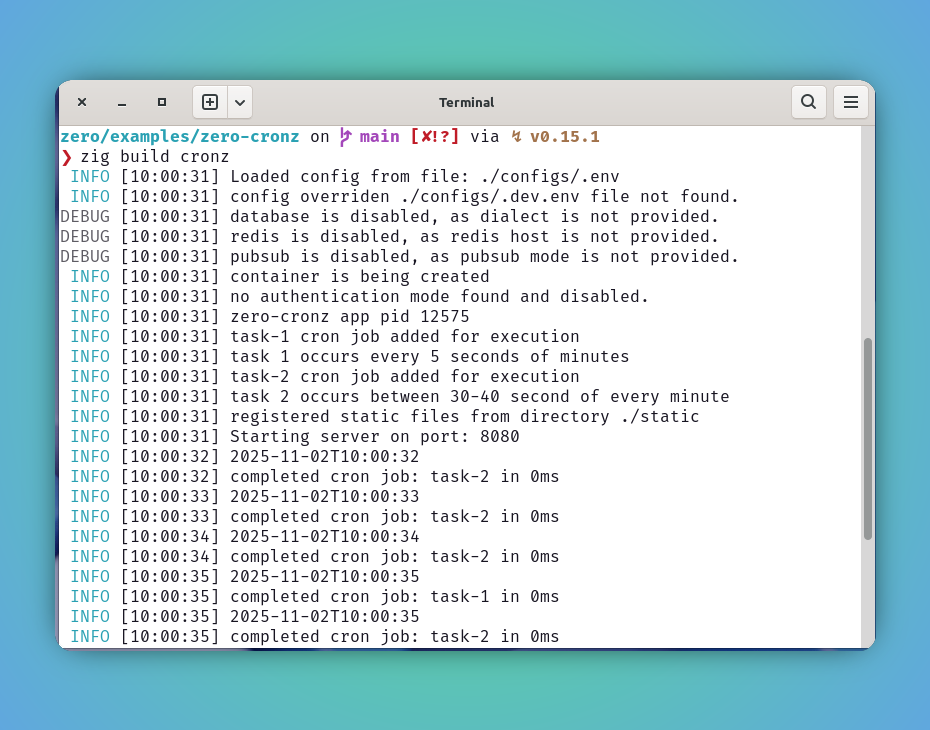

# Scheduling Tasks

`zero` lets you schedule one or more tasks to run automatically in your app.

`zero` uses `crontab` notation. A five-field schedule is the usual one: minute, hour, day of month, month, day of week. Add a sixth field in front when you need seconds.

```bash
minute(s) hours(s) dayOfMonth(s) month(s) dayOfWeek(s)
    *        *          *            *         *

second(s) minute(s) hours(s) dayOfMonth(s) month(s) dayOfWeek(s)
    *         *          *          *           *         *
```

::: warning From 0.5.4
A five-field schedule no longer runs every second. It runs once a minute at
second 0. If you meant "every second", use `* * * * * *` with six fields.
:::

### Cronz

`zero` ships with a built-in scheduler called `cronz`. It lets you schedule one or more tasks that run on the app's container during its lifetime.

You call it with a simple method, so defining and managing jobs stays straightforward.

::: code-group

```zig [method signature]
app.addCronJob("cron-schedule", "task-name", task-handler);
```

```zig [task handler]
fn task1(ctx: *Context) !void {
    # your needed tasks executed here
}
```

:::

### Supported Crontab notations

| Format                 | What it does?                                  | Mode   |
| ---------------------- | ---------------------------------------------- | ------ |
| \* \* \* \* \* \*      | Execute on every second                        |        |
| 1-10 \* \* \* \* \*    | Execute between 1-10 seconds of each minute    | Range  |
| \*/2 \* \* \*          | Execute on every two minutes                   | Split  |
| 0 1,3,5,10 \* \* \* \* | Execute on every 1st, 3rd, 5th and 10th Minute | Repeat |

### Example

This example shows how to schedule tasks with the `zero` built-in `cronz` scheduler.

1. The `zero-cronz` example below shows how to get started.

::: code-group

```zig [main.zig]
const std = @import("std");
const zero = @import("zero");

const App = zero.App;
const Context = zero.Context;

pub const std_options: std.Options = .{
    .logFn = zero.logger.custom,
};

pub fn main(init: std.process.Init) !void {
    var arena_instance = std.heap.ArenaAllocator.init(std.heap.page_allocator);
    defer arena_instance.deinit();

    const allocator = arena_instance.allocator();

    const app = try App.new(allocator, init.io, init.environ_map);

    try app.addCronJob("*/5 * * * * *", "task-1", task1);
    app.container.log.info("task 1 occurs every 5 seconds of minutes");

    try app.addCronJob("[30-40] * * * * *", "task-2", task2);
    app.container.log.info("task 2 occurs between 30-40 second of every minute");

    try app.run();
}

fn task1(ctx: *Context) !void {
    const timestamp = try utils.sqlTimestampz(ctx.allocator);
    ctx.info(timestamp);
}

fn task2(ctx: *Context) !void {
    const timestamp = try utils.sqlTimestampz(ctx.allocator);
    ctx.info(timestamp);
}
```

:::

2. Let's build and run the app.

```bash
zero/examples/zero-cronz on  main via ↯ v0.17.0
❯ zig build cronz
 INFO [10:11:16] Loaded config from file: ./configs/.env
 INFO [10:11:16] config overriden ./configs/.dev.env file not found.
DEBUG [10:11:16] database is disabled, as dialect is not provided.
DEBUG [10:11:16] redis is disabled, as redis host is not provided.
DEBUG [10:11:16] pubsub is disabled, as pubsub mode is not provided.
 INFO [10:11:16] container is being created
 INFO [10:11:16] no authentication mode found and disabled.
 INFO [10:11:16] zero-cronz app pid 13506
 INFO [10:11:16] task-1 cron job added for execution
 INFO [10:11:16] task 1 occurs every 5 seconds of minutes
 INFO [10:11:16] task-2 cron job added for execution
 INFO [10:11:16] task 2 occurs between 30-40 second of every minute
 INFO [10:11:16] registered static files from directory ./static
 INFO [10:11:16] Starting server on port: 8080
 INFO [10:11:20] 2025-11-02T10:11:20
 INFO [10:11:20] completed cron job: task-1 in 0ms
 INFO [10:11:25] 2025-11-02T10:11:25
 INFO [10:11:25] completed cron job: task-1 in 0ms
 INFO [10:11:30] 2025-11-02T10:11:30
 INFO [10:11:30] completed cron job: task-1 in 0ms
 INFO [10:11:30] 2025-11-02T10:11:30
 INFO [10:11:30] completed cron job: task-2 in 0ms
```

3. You can preview the server status and how the jobs repeat.



## Reliability

Each job run is **serialized** with a per-job mutex. If a tick runs longer than its interval, the next one won't start on top of it.

If a run returns an error, `zero` retries it up to **3× with a 500 ms backoff** before marking it failed. Because `job.run` runs inside this guarded scope, a failing handler can't leak a half-finished tick into the next one.

## Recommendation

Use the `ctx` allocator whenever you can. It's tied to the request lifecycle, so `zero` frees the memory for you and prevents leaks.
